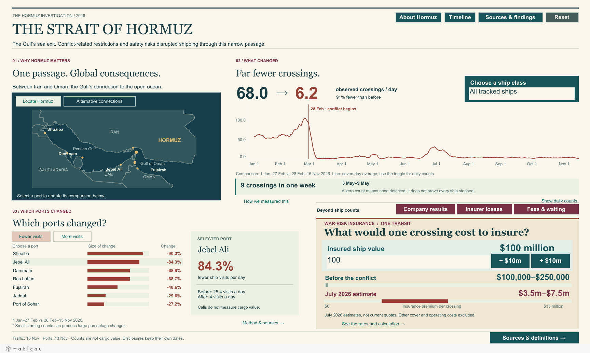

# The Strait of Hormuz

**Ship crossings fell 91%. Why did some ports get busier?**

Hormuz connects the Persian Gulf to the open ocean. I used Python and Tableau to compare traffic before and during the 2026 disruption. The map puts two UAE ports in perspective. Jebel Ali sits inside the Gulf and saw fewer visits. Khor Fakkan sits outside the strait and saw more.

**[Explore the live dashboard](https://public.tableau.com/app/profile/shashank.pabitwar/viz/THESTRAIGHTOFHORMUZ/TheStraitofHormuz)** · **[Download the editable Tableau workbook](https://raw.githubusercontent.com/Shashankpabitwar123/strait-of-hormuz/main/tableau/The%20Strait%20of%20Hormuz.twbx)**

## How I measured the change

I processed **25,908 daily location records** from IMF PortWatch. The [crossings file](data/crossings.csv) covers five maritime chokepoints from January 2019 and contains 14,380 location-days. The [port visits file](data/port_visits.csv) covers 11 selected ports from January 2024 and contains 11,528 port-days. Each row gives one location’s count for one day.

For the dashboard I compared average daily counts from January 1–February 27, 2026 with those from February 28 onward. Crossings run through November 15 and port visits through November 13. Using daily averages makes the two periods comparable despite their different lengths.

| What I measured | Before | During the disruption |
|---|---:|---:|
| Observed Hormuz crossings per day | 68.0 | 6.2 |
| Ship visits per day at Jebel Ali | 25.4 | 4.0 |
| Estimated war-risk premium for one crossing by a ship insured for $100 million | $100,000–$250,000 | $3.5–$7.5 million at July rates |

Seven ports recorded fewer visits and four recorded more. Ship tracking can miss crossings. Visits measure activity, and identifying diverted cargo would require shipment-level evidence.

## Try it

1. Select Jebel Ali on the map, then choose **More visits** and compare Khor Fakkan.
2. Change the ship class to see when tanker or container traffic slowed. Switch to daily counts to see individual days.
3. Change the insured ship value to compare the historical premium ranges. The calculator multiplies that value by each period’s estimated war-risk rates.
4. Open **Sources & findings** for the dates, sources and limits behind 28 research questions, including waiting times and insurer losses.

## Check the numbers

Run `python3 analysis/compare.py` from this repository. It uses the included CSV files and the Python standard library to check for duplicate location-days and print the crossing and port comparisons. To explore or edit the visual analysis, open the packaged workbook in Tableau Desktop or Tableau Public Desktop.

The [research ledger](data/evidence_ledger.csv) links each finding to its original source and records what the evidence can establish. The [timeline](data/events.csv) links to dated maritime advisories. Daily counts come from [IMF PortWatch](https://portwatch.imf.org/).
